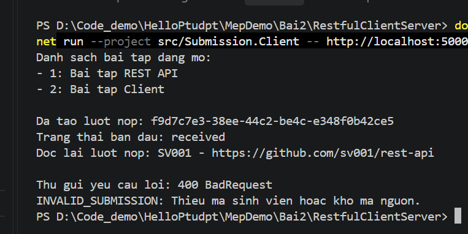
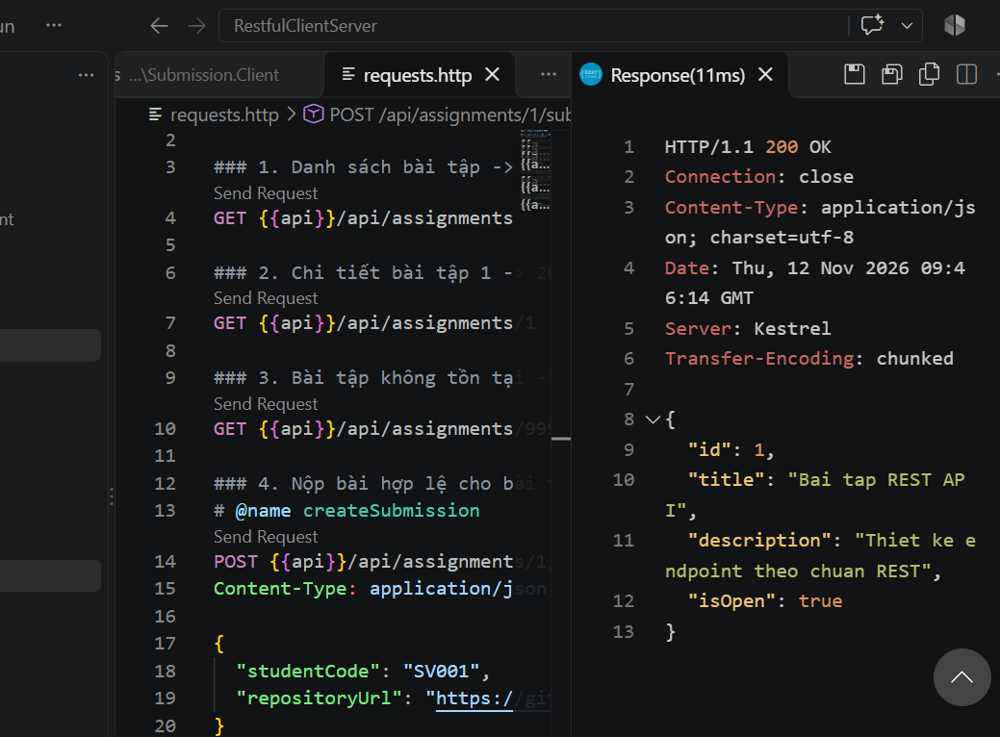
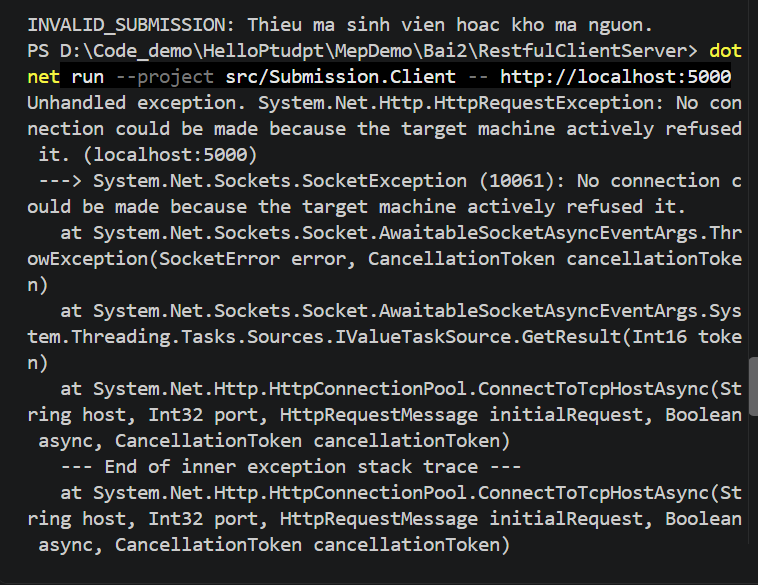

Báo cáo thực hành Bài 2: RESTful API - EduSubmit

1. Các lệnh đã chạy

- Khởi động máy chủ API: `dotnet run --project src/Submission.Api --urls http://localhost:5000`[cite: 74]
- Chạy máy khách Client: `dotnet run --project src/Submission.Client -- http://localhost:5000`[cite: 85]

2.  Kết quả kiểm thử & Ảnh minh chứng

- Ảnh 1: Kết quả chạy `Submission.Client` đủ 4 nấc\*\* (liệt kê bài tập đang mở, tạo lượt nộp mới, đọc lại qua header `Location` và bắt lỗi `400 Bad Request` mà chương trình không bị sập)[cite: 88, 116]:
  
- Ảnh 2: Kết quả chạy kiểm thử bằng `requests.http` (hiển thị phản hồi `201 Created` kèm header `Location` hoặc các ca kiểm thử `200`, `400`, `404`)[cite: 89, 112]:

- Ảnh 3: Minh chứng phá thử khi tắt máy chủ API (Client báo lỗi kết nối mạng `Connection refused` khi server chưa bật hoặc đã tắt)[cite: 61, 88]:
  Minh chung pha thu tat API:

3.  Bảng phá thử hệ thống

| Tình huống phá thử    | Hành động thực hiện                                            | Kết quả quan sát được                                                          | Giải thích                                                                            |
| :-------------------- | :------------------------------------------------------------- | :----------------------------------------------------------------------------- | :------------------------------------------------------------------------------------ |
| **Gửi thiếu dữ liệu** | POST với `studentCode` và `repositoryUrl` rỗng[cite: 81]       | Trả về `400 Bad Request` (`INVALID_SUBMISSION`), Client không bị sập[cite: 88] | Server kiểm tra hợp lệ tại biên hệ thống và trả về lỗi chuẩn `ApiError`[cite: 50, 83] |
| **Nộp bài đã đóng**   | POST vào bài tập số 3 (`IsOpen = false`)[cite: 82]             | Trả về `400 Bad Request` (`ASSIGNMENT_CLOSED`)[cite: 83]                       | Vi phạm quy tắc nghiệp vụ của bài tập[cite: 83]                                       |
| Tìm bài không có      | GET `/api/assignments/999`[cite: 77]                           | Trả về `404 Not Found` (`ASSIGNMENT_NOT_FOUND`)[cite: 77]                      | Tài nguyên không tồn tại trong bộ nhớ máy chủ[cite: 76]                               |
| Tắt máy chủ API       | Tắt Terminal chạy API (`Ctrl+C`) rồi chạy Client[cite: 61, 88] | Client báo lỗi mạng `HttpRequestException: Connection refused`[cite: 61, 88]   | Lỗi kết nối mạng do tiến trình máy chủ không hoạt động[cite: 88]                      |
| Chạy sai cổng         | Chạy Client trỏ tới cổng `http://localhost:5999`[cite: 61, 88] | Client báo lỗi `Connection refused (localhost:5999)`[cite: 61, 88]             | Hai bên không thống nhất đúng địa chỉ URL[cite: 61]                                   |
| Khởi động lại API     | Tắt API rồi bật lại, gọi GET lượt nộp cũ[cite: 84]             | Trả về `404 Not Found` (`SUBMISSION_NOT_FOUND`)[cite: 84]                      | Dữ liệu lưu tạm trên RAM của tiến trình API bị mất khi tắt[cite: 84, 102]             |

4.  Trả lời câu hỏi lý thuyết
    Câu 1: Vì sao URI dùng danh từ, còn hành động do phương thức HTTP đảm nhận?

- URI dùng để định danh tài nguyên trong hệ thống (ví dụ: `/api/assignments`, `/api/submissions`).
- Hành động thao tác lên tài nguyên đó sẽ do các phương thức HTTP chuẩn đảm nhận (`GET` để đọc, `POST` để tạo mới) thay vì đưa động từ vào đường dẫn như `/submitAssignment`.

Câu 2: "Stateless" thể hiện ở đâu trong code đã viết?

- Mỗi yêu cầu từ client gửi lên đều tự mang đầy đủ thông tin cần thiết để server xử lý (`assignmentId` nằm trên URI, `studentCode` và `repositoryUrl` nằm trong body JSON)[cite: 117].
- Máy chủ hoàn toàn không lưu trạng thái phiên làm việc của máy khách giữa các lần gọi[cite: 117].

Câu 3: Vì sao client và server mỗi bên khai báo DTO riêng mà vẫn khớp nhau

- DTO đóng vai trò là bản hợp đồng dữ liệu dưới định dạng JSON ở biên giao tiếp, không phải lớp dùng chung trong bộ nhớ[cite: 117].
- Hai chương trình khớp được dữ liệu nhờ tên trường và kiểu dữ liệu trong chuỗi JSON tương ứng nhau (ví dụ `Id`, `StudentCode`, `RepositoryUrl`), nên không cần tham chiếu trực tiếp project của nhau[cite: 117].
