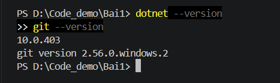
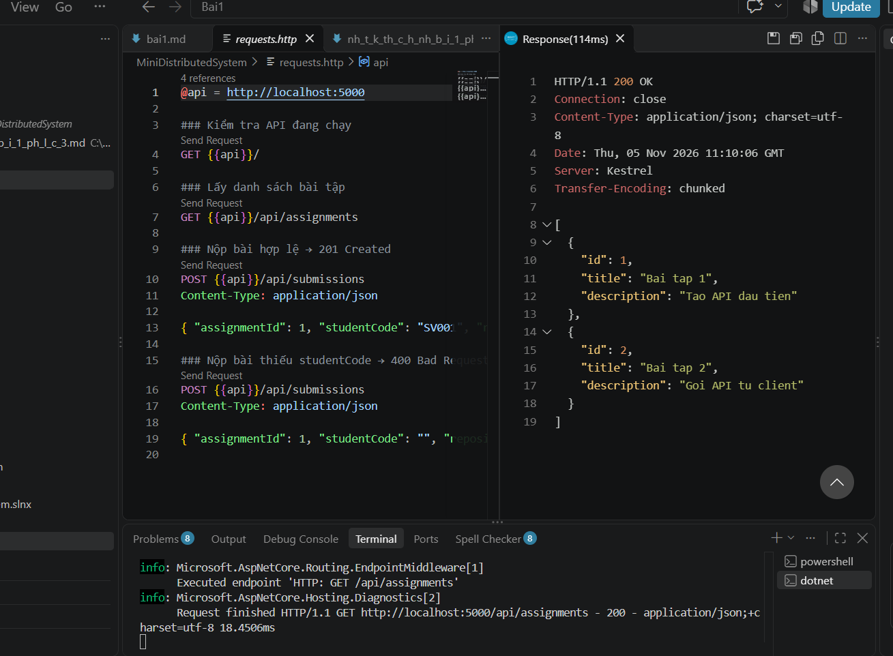
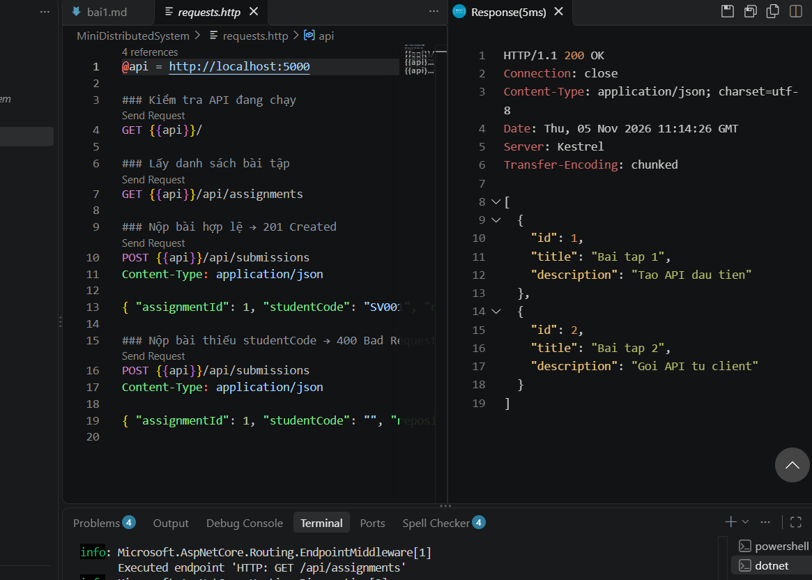
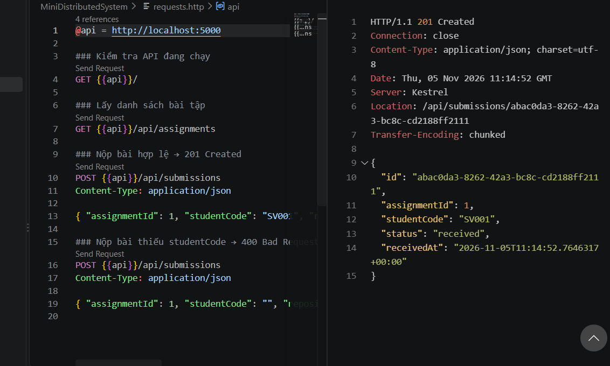
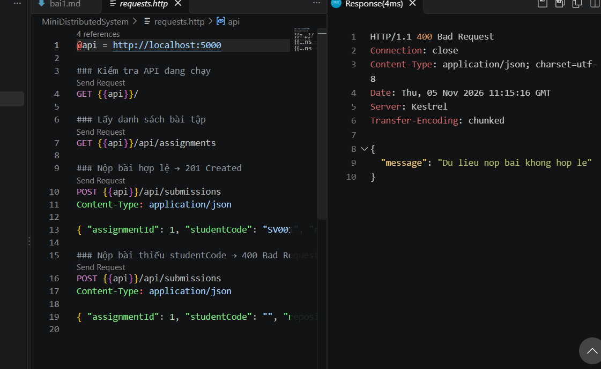
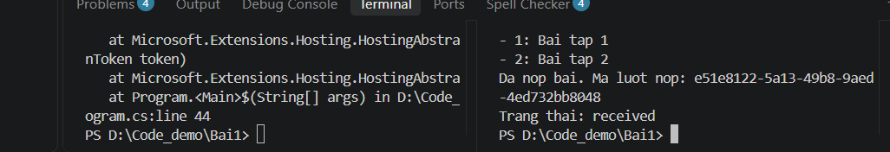

# Bài 1 – Tổng quan hệ thống và MEP

Họ tên: Ma Thị Uyên MSSV: DTC245200424 Lớp: CNTT K23C

## 1. Cài đặt

_Thao tác:_ Đã hoàn thành cài đặt .NET 10 SDK, Visual Studio Code (kèm extension C# Dev Kit, REST Client) và Git.
_Kết quả:_ Kiểm tra `dotnet --version` đạt bản 10.x, `git --version` hoạt động bình thường, chạy thành công dự án `HelloPtudpt`.

``

---

## 2. MepDemo (Bước 7)

### Trả lời câu hỏi:

1. **Ở MEP 3 (Queue-based):** Mỗi bài nộp `sub-x` chỉ do **1 worker** xử lý. Các worker chia sẻ công việc từ hàng đợi chung để tránh xử lý trùng lặp.
2. **Ở MEP 4 (Publish-Subscribe):** Một sự kiện được gửi tới **cả 3 dịch vụ** (các subscriber đăng ký lắng nghe sự kiện đó đều nhận được thông điệp).
3. **Mô tả ngắn gọn cho từng MEP:**
   - **MEP 1 (Request-Response):** Client gửi yêu cầu và chờ Server phản hồi kết quả trực tiếp.
   - **MEP 2 (One-Way):** Client gửi thông điệp tới Server rồi kết thúc, không đợi phản hồi kết quả.
   - **MEP 3 (Queue-Based):** Yêu cầu được đưa vào hàng đợi (Queue), các Worker sẽ lần lượt lấy ra xử lý bất đồng bộ.
   - **MEP 4 (Publish-Subscribe):** Nguồn phát (Publisher) phát sự kiện, tất cả các bên đăng ký (Subscribers) đều nhận được thông điệp đồng thời.
   - **MEP 5 (Streaming):** Kết nối mở liên tục, dữ liệu được truyền liên tiếp theo luồng giữa Client và Server.

---

## 3. BasicWebApi (Bước 8)

### Ảnh chụp REST Client:

 !

- **GET / (200 OK):**
- **POST /greetings hợp lệ (201 Created):**
- **POST /greetings không hợp lệ (400 Bad Request):**

### Trả lời câu hỏi mục 8.4:

1. **Thứ tự builder.Services và app.Build():**
   - Dòng `builder.Services.AddSingleton...` **bắt buộc phải đứng trước** `var app = builder.Build();`.
   - _Vì sao:_ Hàm `builder.Build()` sẽ đóng gói và khởi tạo container phụ thuộc (Dependency Injection Container). Mọi dịch vụ (Services) cần phải được đăng ký vào `builder.Services` trước khi container này được khởi tạo.
2. **Nguồn gốc tham số trong `/hello/{name}?language=en`:**
   - Tham số `name`: Lấy từ **Route Path** (đường dẫn URL).
   - Tham số `language`: Lấy từ **Query String** (chuỗi truy vấn sau dấu `?`).
3. **Mã trả về của POST hợp lệ:**
   - POST hợp lệ trả về `Results.Created` (`201 Created`) thay vì `Results.Ok` (`200 OK`) để tuân thủ chuẩn RESTful API, biểu thị rằng một tài nguyên mới (Resource) đã được khởi tạo thành công trên Server (đi kèm header `Location`).

---

## 4. MiniDistributedSystem (Bước 9)

### Ảnh chụp 2 Terminal (API + Client):

``

### Trả lời câu hỏi:

1. **Các endpoint Client gọi:**
   - `GET http://localhost:5000/api/assignments`: Trả về `200 OK`, danh sách bài tập.
   - `POST http://localhost:5000/api/submissions`: Trả về `201 Created`, thông tin xác nhận lượt nộp bài.
2. **Tham chiếu mã nguồn giữa Client và API:**
   - Client **không** tham chiếu (dùng chung) code của API.
   - Hai bên "thống nhất" với nhau thông qua **Hợp đồng giao tiếp (API Contract)** gồm định dạng URL, phương thức HTTP (GET/POST) và cấu trúc dữ liệu trao đổi (JSON Schema).
3. **Truyền địa chỉ API qua tham số dòng lệnh (`-- http://localhost:5000`):**
   - Giúp ứng dụng linh hoạt, không bị cứng nhắc (hard-coded). Có thể triển khai Client ở các môi trường khác nhau (Local, Staging, Production) chỉ bằng cách thay đổi tham số đầu vào mà không cần biên dịch lại mã nguồn.

---

## 5. Thí nghiệm lỗi (Bước 10)

| #     | Dự đoán                                                       | Kết quả thực tế                                                            | Đúng/Sai | Giải thích                                                                                                                                   |
| ----- | ------------------------------------------------------------- | -------------------------------------------------------------------------- | -------- | -------------------------------------------------------------------------------------------------------------------------------------------- |
| **a** | Client vẫn chạy bình thường và hiển thị thêm bài tập 3.       | Client tự động hiển thị `- 3: Bai tap 3`.                                  | **Đúng** | Client giải mã (deserialize) danh sách từ JSON động của Server nên dữ liệu luôn được cập nhật tự động.                                       |
| **b** | Client văng lỗi do không kết nối được tới máy chủ.            | Văng ngoại lệ `System.Net.Http.HttpRequestException` (Connection refused). | **Đúng** | Giao tiếp mạng phụ thuộc vào trạng thái Server. Khi Server ngừng, socket kết nối bị từ chối, khác với gọi hàm nội bộ trên RAM.               |
| **c** | Server từ chối và trả về mã 400 Bad Request.                  | Client nhận mã 400 và văng ngoại lệ tại `EnsureSuccessStatusCode()`.       | **Đúng** | Server thực hiện kiểm tra dữ liệu (validation). Phía Client dùng `EnsureSuccessStatusCode()` để chủ động bắt lỗi khi HTTP Status $\neq 2xx$. |
| **d** | Đổi cổng gọi của Client sang 5050 qua CLI sẽ chạy thành công. | Client nộp bài thành công, trả về mã GUID lượt nộp (`a7710d0d...`).        | **Đúng** | `baseUrl` được truyền qua tham số `args[0]`, cho phép cấu hình cổng kết nối linh hoạt từ bên ngoài.                                          |

---

## 6. Dự án EduSubmit tự làm (Bước 11-12)

### Ảnh chụp kết quả:

``

- **Phần phải xem code mẫu:** Không xem / Hoàn thành tự lực (hoặc ghi rõ nếu có tham khảo syntax `Results.Created`).
- **Luồng thông điệp trong hệ thống EduSubmit:**
  - `Client` --(HTTP GET `/api/courses`)--> `Api` : Request-Response (Lấy danh sách khóa học)
  - `Client` --(HTTP POST `/api/submissions`)--> `Api` : Request-Response (Nộp bài tập)
  - `Client` --(HTTP GET `/api/submissions/{id}`)--> `Api` : Request-Response (Đọc lại lượt nộp bài - Bài mở rộng)

---

## 7. Khó khăn gặp phải và cách giải quyết

1. **Khó khăn 1:** Nhầm lẫn giữa việc gõ tên thư mục và lệnh trong PowerShell khi thao tác CLI.
   - _Cách giải quyết:_ Đọc kỹ dấu nhắc lệnh (Prompt) của Terminal để xác định đúng thư mục hiện hành trước khi gõ lệnh `dotnet`.
2. **Khó khăn 2:** Đổi cổng API nhưng quên cập nhật URL tương ứng ở Client.
   - _Cách giải quyết:_ Sử dụng tham số truyền động `args[0]` khi khởi chạy dự án Client qua CLI.
